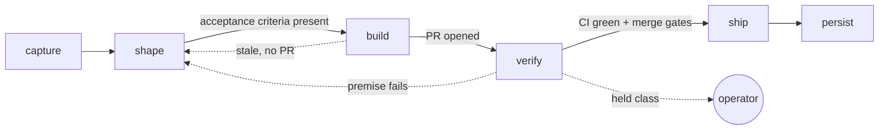

# Julio David Ochoa

552 Studio is a personal AI learning studio — learning and having fun with AI, not a business. This page is the engineering view of that practice: architecture, decisions, tests and numbers. The studio story is on [552.studio](https://552.studio).

| | |
|---|---|
| Focus | agent harnesses · workflow state machines · CI and merge gates · Postgres data modeling |
| Stack | TypeScript (strict) · Node 20/22 · Hono · React 19 + Vite · Next.js 15 · Postgres 16 · MCP · pnpm workspaces · Vitest · Playwright · Biome · Railway |
| Education | MS Information Systems, Washington University in St. Louis · BS Computer Engineering, Universidad Simón Bolívar |
| Based | New York · English and Spanish |

## By the numbers (verified 2026-11-24 14:28 ET)

| Figure | Source |
|---|---|
| **3,595 merged pull requests across 17 repositories (Jan–Nov 24, 2026, verified 2026-11-24 14:28 ET)** | GitHub search API, one query per owned repository: `is:pr is:merged repo:juliodavid8a/{repo} merged:2026-01-01..2026-11-24`. 17 of 20 owned repos had at least one merged PR. Cross-checked with `is:pr is:merged user:juliodavid8a merged:2026-01-01..2026-11-24`. |
| **2,576** work items (Forms) taken to the final `persist` phase | Perse workspace summary (as of 2026-11-18) |
| **10,768** passing tests in the Perse server suite, run in 3 shards | Perse CI, main-line run of Nov 18 |
| **184** forward-only SQL migrations in Perse (numbered 001 to 189) | `packages/store/src/migrations` |
| **~186k** lines of TypeScript source and **~238k** lines of tests in Perse | `git ls-files` + `wc -l`, blank lines included (as of 2026-11-18) |
| **232** autonomous agent sessions in the last 24 hours | Perse workspace summary (as of 2026-11-18) |

All repositories below are private except this profile README. Links go to public write-ups on 552.studio.

Nothing is live or launched. Perse, Apolonia, and CasaCommand are in friends-and-family testing. Everything else is not launched.

---

## Perse: the delivery harness

[Write-up](https://552.studio/work/proj-perse) · friends-and-family testing · TypeScript monorepo (`apps/server`, `apps/web`, `packages/{core,store,verify,connect,realtime,ai-gateway}`)

A self-hosted runtime that turns a structured work item into a merged, tested pull request, and records what happened. One person sets intent and reviews the risky diffs; the mechanical work runs on cron-driven lanes.

**Data model.** The unit of work is a Form: one row with `level` (vision / objective / task), `intent`, `constraints`, `acceptance` (JSONB), `phase` and an integer `version` for optimistic locking. History lives in an insert-only `enrichments` table; Forms are enriched at each transition, not rewritten. A wiki and a knowledge graph (`knowledge_nodes`, `knowledge_edges`) sit in the same database, so agent memory is a query, not a context window. Every query is scoped to a workspace.

**Dispatch.** A builder claims the next Form through one predicate: phase is `shape`, acceptance criteria are non-empty, the repo has build slots free, the Form's declared file scope is disjoint from every Form already in build, and spending is not paused. A Postgres advisory lock serializes claims per workspace and repo, so two lanes can't pick the same work or overlapping files.

**Workers.** Agents are ephemeral. Each one reads its Form over MCP, does the work, reports an outcome and exits. Workers never talk to each other; coordination happens through shared state. The harness can drive several coding-agent runtimes. A pure failover function picks the first healthy runtime in a lane's chain on every fire, and a UNIQUE slot key in the dispatch ledger means a lane never fires twice in one slot.

**Credential isolation.** A local agent process never holds the real GitHub or model credential. It gets a per-fire capability for a loopback broker. The git broker forwards fetch and push for one repository only, and refuses deletions, tags, the default branch and any branch not bound to a live Form. The model proxy forwards only to one configured origin and path prefix, after URL normalization. Both inject the real credential server-side and stop when the fire ends. These came out of an internal security audit.

**Liveness and failure handling.**
- *Reaper:* a session that dies before reporting would hold its routine's single in-flight row forever. The reaper stamps rows past their TTL as closed with a recorded reason. It stamps rather than deletes, and it runs before any slot is considered.
- *Stale sweeper:* moves stuck Forms along evidence-backed edges. A Form in build with no PR and no progress goes back to shape. A Form in verify whose PR has merged goes forward to ship, as a backstop for a missed webhook. Red CI with no progress becomes one owner action.
- *Clog detector:* evaluates a window, not a slot, and reports three conditions: starved (claimable work, no builder fired), failing (an error streak) and dying (sessions reaped).
- *Lane liveness:* infers stalls from fire evidence, not self-reports, and resolves its own alerts once the evidence clears.
- Failures are loud no-ops: every skipped or failed step writes an outcome row. A silent success counts as a bug.

**Merge gates.** A pure classifier assigns each changed path a class: `docs`, `test`, `source`, `authority`, `deploy` or `loop-canon`. The highest class sets the review floor. `deploy` and `loop-canon` (CI config, merge machinery, the agents' own instructions) are held for a human. Everything else can auto-merge on green. The auto-merge resolver re-checks the flagged head SHA, park state, a premise recheck against the merge base, every check run, and mergeability before enqueueing into the GitHub merge queue. The webhook and the deferred-merge pass call the same function.

**MCP surface.** Perse exposes its tools over MCP, authorized with OAuth and PKCE. Tokens are opaque and only their SHA-256 is stored, so a database leak yields no usable tokens. Workspaces can federate external MCP servers. Their tools are namespace-prefixed and routed back to the right backend, with a 5 s timeout so a broken integration never blocks a worker. Sign-in uses passwords (Argon2) or passkeys (WebAuthn).

**Design-time validation.** A rule-based validator checks a Form's wording at shaping (warn) and at the build boundary (reject), because vague specs produce vague diffs. Builders work refute-first: before writing code they confirm that every file and symbol the spec names exists, and they return the Form for rework if not.

---

## How the line verifies work

- **Required checks on every PR** (Perse): `gates` (scope enforcement, commit trailers, migration lint), `build-and-test`, `e2e` (Playwright), `docker-build`, `docs-lint`, `smoke`. A daily scheduled run keeps the full suite exercised when main is quiet.
- **Self-hosted runners with a hosted fallback.** A picker job reads the repo's runner list and sends heavy jobs to an online self-hosted Mac, or to `ubuntu-latest` otherwise. Each runner instance gets its own Postgres database (`perse_ci_<runner>`). Jobs that hold secrets are pinned to hosted runners and never run PR-controlled code on the self-hosted machine. A watchdog job cancels the run if no self-hosted job starts within 15 minutes and the runner isn't busy elsewhere.
- **Structural gates as tests.** Workflow files are covered by tests (action pinning, trusted checkout, shard layout, runner picker). Architecture rules are enforced with dependency-cruiser and file-size gates. Deliberately failing fixtures prove the gates still fire.
- **Scope fences.** A Form declares the files it may touch (`files_touched`). The `gates` job checks the diff against that list mechanically. Inside `gates`, the steps that hold tokens run before any step that executes PR-supplied code (`pnpm install`, build), so a PR can't tamper with the runner before a secret is in use.
- **Reversibility is the merge rule.** Ordinary changes merge on green, are verified in production, and revert in one command. Auth, secrets, tenant isolation, deploy config and the loop's own machinery wait for review. When in doubt, the rule holds the PR.

---

## Products built on the line

Nothing is live or launched. Perse, Apolonia, and CasaCommand are in friends-and-family testing. Everything else is not launched.

**[Perse](https://552.studio/work/proj-perse)** · friends-and-family testing · the delivery harness described above.

**[Apolonia](https://552.studio/work/proj-apolonia)** · friends-and-family testing · job-market monitoring and scoring agent
- Ingestion adapters for job APIs, RSS feeds and IMAP mail, normalized into Postgres and scored against written criteria. Outputs: a daily report and two alert tiers over Web Push.

**[CasaCommand](https://552.studio/work/proj-casacommand)** · friends-and-family testing · natural-language intake into shared task cards
- Passkey auth, Web Push, and first-boot provisioning from the UI with no separate ops step.

**[Xray](https://552.studio/work/proj-xray)** · not launched · repository health scoring with fixes as PRs
- Pipeline split into packages with an enforced dependency direction: `analyzers` → `scoring` (pure and deterministic, no I/O) → `patch`, the only package allowed to write to a scanned repo.

**[Pythia](https://552.studio/work/proj-pythia)** · not launched · multi-agent deliberation for portfolio decisions, in simulation only
- Trading is off by design. It needs an explicit flag and a passing evaluation-harness gate, and neither is set.

**Provisions** · not launched · private
- Provisions is the evolution of GrocerBot, with monarch.com vibes: a household grocery and family-finance agent.

**Trail Walker** · not launched · private · Android app that turns treadmill walks into a virtual long-distance hike

**Factoria** · the studio site (Next.js 15) renders its copy and figures from Postgres rows, not from components. Public at [552.studio](https://552.studio). 552 Studio is a personal AI learning studio — learning and having fun with AI, not a business.

---

## Earlier tools

The harness grew out of these, all private and not launched:

- **Flow**: energy-aware task scheduling with a messaging interface and an MCP server.
- **Personal Wiki**: knowledge graph with spaced repetition. Its MCP tools became the first orchestrator.
- **Ship Lab**: automated audit labs (security, QA, cost, compliance).
- **CC-Runner**: headless coding-agent execution over MCP; the first harness.

## MiniGPT

MiniGPT is early and in progress; the model is not implemented. Tokenizer, config, and data-loader work is under way as part of a planned nine-part v1. MiniRLHF and MiniAgent are not built.

---

