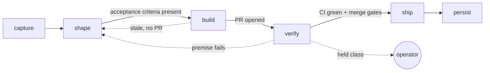

# Julio David Ochoa

I build the control plane for autonomous software delivery: a Postgres-backed harness that takes a written work item through shaping, a coding agent, CI, merge and a durable record, and the products that have shipped through it. This page is the engineering view: architecture, decisions, tests and numbers. The studio story is on [552.studio](https://552.studio).

| | |
|---|---|
| Focus | agent harnesses · workflow state machines · CI and merge gates · Postgres data modeling |
| Stack | TypeScript (strict) · Node 20/22 · Hono · React 19 + Vite · Next.js 15 · Postgres 16 · MCP · pnpm workspaces · Vitest · Playwright · Biome · Railway |
| Education | MS Information Systems, Washington University in St. Louis · BS Computer Engineering, Universidad Simón Bolívar |
| Based | New York · English and Spanish |

## By the numbers (verified 2026-11-18)

| Figure | Source |
|---|---|
| **3,422** merged pull requests across my repositories | GitHub search API, `is:pr is:merged user:juliodavid8a` |
| **2,576** work items (Forms) taken to the final `persist` phase | Perse workspace summary |
| **10,768** passing tests in the Perse server suite, run in 3 shards | Perse CI, main-line run of Nov 18 |
| **184** forward-only SQL migrations in Perse (numbered 001 to 189) | `packages/store/src/migrations` |
| **~186k** lines of TypeScript source and **~238k** lines of tests in Perse | `git ls-files` + `wc -l`, blank lines included |
| **232** autonomous agent sessions in the last 24 hours | Perse workspace summary |

All repositories below are private. Links go to public write-ups on 552.studio.

---

## Perse: the delivery harness

[Write-up](https://552.studio/work/proj-perse) · 1,632 merged PRs · TypeScript monorepo (`apps/server`, `apps/web`, `packages/{core,store,verify,connect,realtime,ai-gateway}`)

A self-hosted runtime that turns a structured work item into a merged, tested pull request, and records what happened. One person sets intent and reviews the risky diffs; the mechanical work runs on cron-driven lanes.

**Data model.** The unit of work is a Form: one row with `level` (vision / objective / task), `intent`, `constraints`, `acceptance` (JSONB), `phase` and an integer `version` for optimistic locking. History lives in an insert-only `enrichments` table; Forms are enriched at each transition, not rewritten. A wiki and a knowledge graph (`knowledge_nodes`, `knowledge_edges`) sit in the same database, so agent memory is a query, not a context window. Every query is scoped to a workspace.

**Dispatch.** A builder claims the next Form through one predicate: phase is `shape`, acceptance criteria are non-empty, the repo has build slots free, the Form's declared file scope is disjoint from every Form already in build, and spending is not paused. A Postgres advisory lock serializes claims per workspace and repo, so two lanes can't pick the same work or overlapping files.

**Workers.** Agents are ephemeral. Each one reads its Form over MCP, does the work, reports an outcome and exits. Workers never talk to each other; coordination happens through shared state. The harness can drive several coding-agent runtimes. A pure failover function picks the first healthy runtime in a lane's chain on every fire, and a UNIQUE slot key in the dispatch ledger means a lane never fires twice in one slot.

**Credential isolation.** A local agent process never holds the real GitHub or model credential. It gets a per-fire capability for a loopback broker. The git broker forwards fetch and push for one repository only, and refuses deletions, tags, the default branch and any branch not bound to a live Form. The model proxy forwards only to one configured origin and path prefix, after URL normalization. Both inject the real credential server-side and stop when the fire ends. These came out of an internal security audit.

**Liveness and failure handling.**
- *Reaper:* a session that dies before reporting would hold its routine's single in-flight row forever. The reaper stamps rows past their TTL as closed with a recorded reason. It stamps rather than deletes, and it runs before any slot is considered.
- *Stale sweeper:* moves stuck Forms along evidence-backed edges. A Form in build with no PR and no progress goes back to shape. A Form in verify whose PR has merged goes forward to ship, as a backstop for a missed webhook. Red CI with no progress becomes one owner action.
- *Clog detector:* evaluates a window, not a slot, and reports three conditions: starved (claimable work, no builder fired), failing (an error streak) and dying (sessions reaped).
- *Lane liveness:* infers stalls from fire evidence, not self-reports, and resolves its own alerts once the evidence clears.
- Failures are loud no-ops: every skipped or failed step writes an outcome row. A silent success counts as a bug.

**Merge gates.** A pure classifier assigns each changed path a class: `docs`, `test`, `source`, `authority`, `deploy` or `loop-canon`. The highest class sets the review floor. `deploy` and `loop-canon` (CI config, merge machinery, the agents' own instructions) are held for a human. Everything else can auto-merge on green. The auto-merge resolver re-checks the flagged head SHA, park state, a premise recheck against the merge base, every check run, and mergeability before enqueueing into the GitHub merge queue. The webhook and the deferred-merge pass call the same function.

**MCP surface.** Perse exposes its tools over MCP, authorized with OAuth and PKCE. Tokens are opaque and only their SHA-256 is stored, so a database leak yields no usable tokens. Workspaces can federate external MCP servers. Their tools are namespace-prefixed and routed back to the right backend, with a 5 s timeout so a broken integration never blocks a worker. Sign-in uses passwords (Argon2) or passkeys (WebAuthn).

**Design-time validation.** A rule-based validator checks a Form's wording at shaping (warn) and at the build boundary (reject), because vague specs produce vague diffs. Builders work refute-first: before writing code they confirm that every file and symbol the spec names exists, and they return the Form for rework if not.

---

## How the line verifies work

- **Required checks on every PR** (Perse): `gates` (scope enforcement, commit trailers, migration lint), `build-and-test`, `e2e` (Playwright), `docker-build`, `docs-lint`, `smoke`. A daily scheduled run keeps the full suite exercised when main is quiet.
- **Self-hosted runners with a hosted fallback.** A picker job reads the repo's runner list and sends heavy jobs to an online self-hosted Mac, or to `ubuntu-latest` otherwise. Each runner instance gets its own Postgres database (`perse_ci_<runner>`). Jobs that hold secrets are pinned to hosted runners and never run PR-controlled code on the self-hosted machine. A watchdog job cancels the run if no self-hosted job starts within 15 minutes and the runner isn't busy elsewhere.
- **Structural gates as tests.** Workflow files are covered by tests (action pinning, trusted checkout, shard layout, runner picker). Architecture rules are enforced with dependency-cruiser and file-size gates. Deliberately failing fixtures prove the gates still fire.
- **Scope fences.** A Form declares the files it may touch (`files_touched`). The `gates` job checks the diff against that list mechanically. Inside `gates`, the steps that hold tokens run before any step that executes PR-supplied code (`pnpm install`, build), so a PR can't tamper with the runner before a secret is in use.
- **Reversibility is the merge rule.** Ordinary changes merge on green, are verified in production, and revert in one command. Auth, secrets, tenant isolation, deploy config and the loop's own machinery wait for review. When in doubt, the rule holds the PR.

---

## Products built on the line

**[Xray](https://552.studio/work/proj-xray)** · repository health scoring with fixes as PRs · 163 merged PRs · 1,821 tests (CI, Nov 11)
- Pipeline split into packages with an enforced dependency direction: `analyzers` (clone, AST, coverage, Semgrep, OSV, jscpd, dependency-cruiser) → `scoring` (pure and deterministic, no I/O, never imports analyzers) → `patch`, the only package allowed to write to a scanned repo.
- Honesty rules are enforced by gate tests. A failed analyzer reports a degraded result and never shows as healthy. Sampled scans never claim high confidence. The composite score caps at 95 and shows the reason.
- Fixes arrive only as PRs through a GitHub App (`contents:write`, `pull_requests:write`, `checks:read`). It never commits directly or auto-merges. It re-scans the PR branch and posts the realized score change, even when that misses the projection.
- React Three Fiber 3D view of the codebase, Hono + Better Auth, Postgres with plain forward-only SQL migrations and no ORM. A cohort regression harness keeps scoring thresholds stable.

**[Apolonia](https://552.studio/work/proj-apolonia)** · job-market monitoring and scoring agent · 280 merged PRs · 1,626 tests (CI, Nov 18) · 52 migrations
- Ingestion adapters for job APIs, RSS feeds and IMAP mail, normalized into Postgres and scored against written criteria. Outputs: a daily report and two alert tiers over Web Push.
- An in-app assistant whose model spend is metered by a ledger with a hard monthly limit. Without a configured limit, engine calls are refused.
- Boot-time env validation: the server refuses to start without its required secrets. Optional features degrade loudly and are reported in `/api/health`.
- Hono API + React 19 PWA with a service worker. Migrations and an idempotent seed run at boot. Database tests run against Postgres 16 in CI.

**[Pythia](https://552.studio/work/proj-pythia)** · multi-agent deliberation for portfolio decisions · paper mode · 388 tests
- Each cycle gathers context, drafts a strategy, has several models debate to consensus, then executes through a brokerage MCP behind execution guards, reconciliation and a circuit breaker.
- Live trading is off by design. It needs an explicit flag and a passing evaluation-harness gate, and neither is set. Paired up/down SQL migrations and a shadow book for evaluation.

**[CasaCommand](https://552.studio/work/proj-casacommand)** · natural-language intake into shared task cards · 503 tests
- Hono + React 19 PWA, passkey auth, Web Push, and first-boot provisioning from the UI with no separate ops step.

**Trail Walker** · Android app that turns treadmill walks into a virtual long-distance hike · 25 merged PRs · private
- Expo / React Native (TypeScript, expo-router). Reads live speed and distance over Bluetooth LE: a FitShow-protocol walking pad, decoded against the real hardware, plus a standard FTMS adapter.
- An Android foreground service keeps capturing while the screen is locked. Sessions persist to SQLite incrementally and recover after a crash or force-kill.
- Distance is mapped onto a real route with elevation. Calories use a grade-aware ACSM walking model. Strava upload goes through OAuth brokered by a stateless worker that stores nothing.
- Local-first and free to run: no account, works offline, and needs no paid backend.

**Provisions** · conversational grocery-ordering agent · pre-launch · private
- A pasted WhatsApp shopping list is parsed by a language model into structured items. The items are matched against a live commerce catalog (SAP Commerce Cloud OCC) and assembled into a cart.
- Hono + Postgres (postgres.js, SQL migrations), phone-OTP sign-in delivered through the WhatsApp Cloud API with Better Auth, and a React 19 + Vite front end.
- Delegated payment authorization with verifiable intent proofs, bill splitting and spending visibility. Live login waits on messaging-platform template approval. The OTP path is built and tested against a stubbed sender.

**Factoria** · the studio site (Next.js 15) renders its copy and figures from Postgres rows (94 migrations), not from components. It builds and runs with no database, falling back to seed constants. Every public route is smoke-tested after deploy, and Lighthouse assertions cover performance. Public at [552.studio](https://552.studio).

---

## Earlier tools

The harness grew out of these, all private:

- **Flow**: energy-aware task scheduling with a messaging interface and an MCP server.
- **Personal Wiki**: knowledge graph with spaced repetition. Its MCP tools became the first orchestrator.
- **Ship Lab**: automated audit labs (security, QA, cost, compliance).
- **CC-Runner**: headless coding-agent execution over MCP; the first harness.

## ML from first principles

From-scratch implementations in PyTorch, written to understand the parts rather than to fine-tune:
**MiniGPT** (character-level transformer: attention, positional encoding, autoregressive sampling) · **MiniRLHF** (reward model on preference pairs, PPO with KL penalty) · **MiniAgent** (tool use, planning, memory).

---

## Experience

Eighteen years across software engineering, enterprise IT delivery, product management and technical program leadership. Employers are described by industry.

| Years | Role | Engineering scope |
|---|---|---|
| 2026 – now | Independent builder, [552.studio](https://552.studio) | Architect, operator and final reviewer of the systems above: the delivery harness, its CI and merge gates, and seven products. |
| 2018 – now | Principal / Lead Technical Program Manager, large financial-technology company | Led transformation programs spanning **250+ developers and 70+ product team members**, from planning and dependency management to risk, steering and production launch with external platform partners. Turned complex platform capabilities into delivery roadmaps with explicit scope, milestones, acceptance criteria and ownership. Ran annual secure-coding readiness for **200+ engineers**. Embedded Agile practices that sustained a **10%+ velocity gain over seven months at 95% shipping predictability**. Introduced an operating model for **170 engineers** that improved predictability by **25%** and sprint acceptance by **50%**. Now leads governance for technology-assurance audit portfolios (SOC 1, SOC 2, ISAE): remediation across vulnerability management, access reviews and security monitoring. Built the team's reporting suite (Python normalization pipeline, data model, Power BI) and a knowledge assistant grounded in 31 curated sources with confidence scoring and source references. Earlier in this period: lead program manager for an anti-money-laundering automation initiative across eight internal teams and a vendor, and consent-management cycle time cut from **20 days to 8**. |
| 2016 – 2017 | Product Manager, payment-processing company | Migrated **6,000 merchant clients** to a new card-network pricing program, adding **$120K/month** in gross margin. Designed a platform feature with **$95K** projected three-year savings. Extended backlog forecasting from one sprint to four across four teams. |
| 2010 – 2014 | New Technologies Analyst / IT Project Manager, large consumer-goods manufacturer | Integrated **eight B2B remote-check-deposit solutions across 115 facilities**, handling **2M+ transactions a month**. Cash flow rose **80%** and processing time fell **66%**. Also deployed enterprise collaboration and digital-signage platforms. |
| 2008 – 2010 | Web Application Developer, banking-technology vendor | Designed three online-banking modules (Java EE: JSP, EJB, SQL). Wrote C++ customizations for an **80-ATM** estate. |

---

